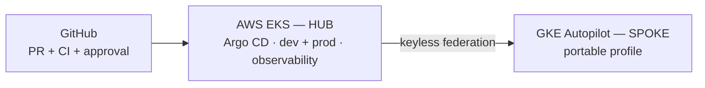

# Sec-GitOps Platform — Executive Summary

**From Commit to Confidence: a secure GitOps hub-and-spoke platform for resilient multi-cloud delivery**

**Sebastien Ngembou** · Senior Cloud Architect / DevOps Lead · [github.com/ngems1](https://github.com/ngems1)

> Full technical README: [README.md](README.md) · Architecture: [docs/architecture.md](docs/architecture.md)

---

## In one sentence

A production-style platform where **every change is tested, approved, signed, released
progressively, automatically reversible, and continuously reconciled** — running a 12-service retail
application on **AWS EKS**, with a portable profile on **GKE Autopilot** governed by the same Argo CD.

## The problem it solves

Shipping fast is easy. Shipping **safely** is hard: code breaks production, infrastructure leaks data
or money, vulnerable images slip through, manual fixes create drift, and every cloud has its own
rules. This platform makes **safe change the default**.

## How it works

```text
Validate → Approve → Build → Scan → Sign → Deploy progressively → Observe → Roll back / Self-heal
```



## Key results

| Area | Outcome |
|---|---|
| **Security** | CodeQL SAST, gitleaks, Checkov, ECR scan gate on CRITICAL, Syft SBOMs, cosign keyless signing, Kyverno verification |
| **Identity** | Zero long-lived cloud keys — GitHub OIDC to AWS and GCP, per-service EKS Pod Identity |
| **Delivery** | Same immutable artifact from dev to prod; frontend canary 20% → 50% → 100% with Prometheus analysis |
| **Reliability** | 5 automated rollback paths; new Pod Ready in **5 s with 0 failed requests** under chaos testing |
| **Scale** | HPA made the home page **~10× faster** under an 800-user stress test |
| **Isolation** | Dev → prod proven blocked at network, IAM and data layers after every prod deploy |
| **Observability** | Metric → exemplar → trace → log in one click (Prometheus, Grafana, Tempo, OpenTelemetry) |
| **Responsible AI** | Bedrock shopping assistant with read-only tools, PII masking, rate/token/cost caps, budget alerts |
| **Cost** | ~9–12 USD/day while running; shared cluster with strict isolation; one-click destroy |
| **Multi-cloud** | GKE spoke deployed by the EKS hub; Autopilot rules encoded as a CI contract (PR #88) |

## Proof point: PR #88

GKE Autopilot silently rewrote undersized resource requests, so Argo CD reported false drift.
Instead of accepting it, the fix **encoded Autopilot's rules in Helm values and added a CI check on
rendered manifests**. Cloud-provider behavior became a **tested platform contract** — Git stays the
source of truth on every cloud.

## Technology

`AWS EKS` `GKE Autopilot` `Terraform` `Helm` `Argo CD` `Argo Rollouts` `GitHub Actions` `OIDC`
`cosign` `Syft` `Kyverno` `CodeQL` `Checkov` `gitleaks` `Prometheus` `Grafana` `Tempo`
`OpenTelemetry` `EventBridge` `SQS` `Lambda` `RDS` `DynamoDB` `ElastiCache` `Amazon Bedrock`
`Go` `Python` `C#/.NET` `Java` `Node.js` `gRPC`

## Skills demonstrated

- **Platform engineering** — paved-road delivery, GitOps, guardrails as code
- **DevSecOps** — SAST, secrets, IaC and image scanning, SBOM and signed provenance
- **Cloud security** — keyless identity, least privilege, permission boundaries, network isolation
- **SRE** — progressive delivery, automated rollback, chaos and load testing, SLIs, runbooks
- **Multi-cloud architecture** — hub-and-spoke control plane across AWS and GCP
- **FinOps** — right-sizing from real data, sampling, budgets, disposable environments
- **AI governance** — cost, data and permission controls for an LLM workload

## Honest maturity

Self-healing today at the **workload, deployment, configuration and event** layers. Next:
Kyverno to enforce mode, blocking Checkov, WAF, observability HA, DR drills, and **safe AIOps** with
human-approved remediation.

---

*"We are not building a faster deployment pipeline. We are building a platform where change is safe
by default."*
