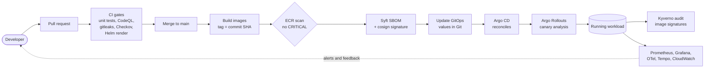
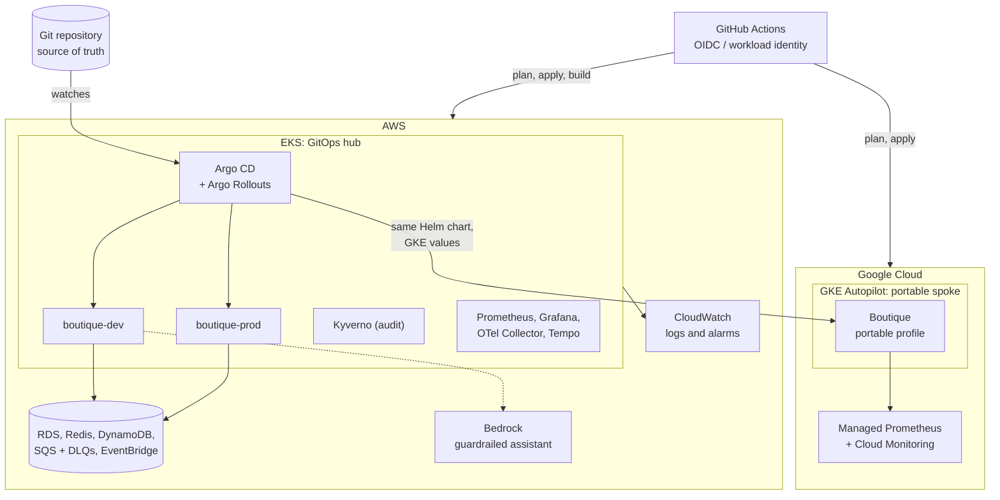
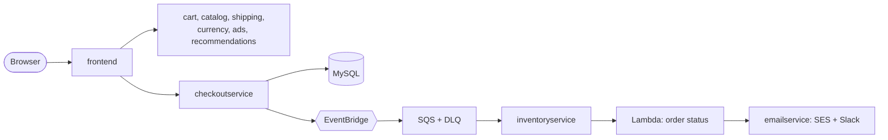

# Sec-GitOps Platform — Executive Overview

**A secure GitOps hub-and-spoke platform for resilient multi-cloud Kubernetes delivery.**

[](https://github.com/ngems1/Sec-GitOps-platform/actions/workflows/deploy.yml)
[](https://github.com/ngems1/Sec-GitOps-platform/actions/workflows/ci.yml)
[](https://github.com/ngems1/Sec-GitOps-platform/actions/workflows/infra.yml)
[](https://github.com/ngems1/Sec-GitOps-platform/actions/workflows/codeql.yml)

> A condensed portfolio view for recruiters, hiring managers and reviewers. For the full
> operational manual, see the [main README](README.md).

| | |
|---|---|
| **Role demonstrated** | Platform / cloud / DevOps / DevSecOps engineering |
| **Workload** | Online Boutique retail system, 13 container images, 5 languages, gRPC |
| **Hub** | AWS EKS, with Argo CD and Argo Rollouts |
| **Spoke** | GKE Autopilot, deployed by the same Argo CD and the same Helm chart |
| **Delivery** | GitHub Actions, keyless (OIDC / workload identity), signed images |
| **Author** | Sebastien Ngembou, [github.com/ngems1](https://github.com/ngems1) |

---

## Contents

1. [The problem](#the-problem)
2. [The solution](#the-solution)
3. [Secure delivery lifecycle](#secure-delivery-lifecycle)
4. [Hub and spoke architecture](#hub-and-spoke-architecture)
5. [Implemented capabilities](#implemented-capabilities)
6. [Implemented vs roadmap](#implemented-vs-roadmap)
7. [Evidence of engineering depth](#evidence-of-engineering-depth)
8. [Cost controls](#cost-controls)
9. [Architecture and repository map](#architecture-and-repository-map)
10. [Run it locally](#run-it-locally)
11. [Further reading](#further-reading)

---

## The problem

Teams that run Kubernetes on more than one cloud usually face the same issues:

- **Slow, risky releases.** Deployments are hand-run and hard to roll back.
- **Long-lived credentials.** Cloud keys sit in CI systems and become a breach path.
- **Unverified artifacts.** Nobody can prove what is running or who built it.
- **Provider drift.** The same manifests behave differently per cloud, and GitOps tools
  report endless "out of sync" noise.
- **Surprise bills.** Cloud and AI usage costs grow quietly.

## The solution

One Git repository is the source of truth. A single **hub** cluster on AWS EKS runs Argo CD and
delivers the same Helm chart to its own environments and to a **portable spoke** on GKE
Autopilot. Provider differences live in small values files, not in forked manifests.

| Value | How it is delivered |
|---|---|
| **Security by default** | Keyless CI, SAST, secret and IaC scanning, signed images with SBOMs, admission auditing |
| **Repeatable delivery** | Immutable SHA-tagged images, Argo CD reconciliation, canary releases, automatic rollback |
| **Portability** | One chart, per-provider values (`values-aws.yaml`, `values-gcp.yaml`), CI checks that keep them aligned |
| **Observability** | Metrics, traces and logs connected, with SLI dashboards and alerts |
| **Cost awareness** | Budgets, caps, retention and lifecycle policies, teardown-on-demand infrastructure |

---

## Secure delivery lifecycle



Each stage fails closed: a vulnerable image, a leaked secret or a bad Terraform change stops the
pipeline before anything reaches a cluster. Production follows development behind a manual
approval and runs exactly the images that passed in dev.

## Hub and spoke architecture



The hub is where the platform logic lives. The spoke deliberately runs a smaller, portable
profile of the application, which proves the chart and the delivery model are not tied to one
provider.

---

## Implemented capabilities

Everything in this section exists in the repository today.

### Delivery and infrastructure

| Capability | What it demonstrates |
|---|---|
| **GitHub Actions** | CI, infra, deploy, rollback, chaos, load and operations workflows; `ci-ok` required check on `main` |
| **OIDC / workload identity** | No stored cloud keys: read-only roles for pull requests, deploy roles trusted only from `main` and protected environments, on AWS and GCP |
| **Terraform** | Bootstrap and main stacks for AWS and for GCP: VPC, EKS, ECR, RDS, Redis, DynamoDB, EventBridge, SQS, Lambda, KMS, IAM, DNS, GKE |
| **Amazon EKS** | Hub cluster hosting dev and prod in isolated namespaces, with Pod Identity and deny-all NetworkPolicies |
| **GKE Autopilot** | Second cluster reached by the same Argo CD, running the portable profile |
| **Helm** | One chart for all services, with per-environment and per-provider values |
| **Argo CD** | GitOps reconciliation; dev follows `main`, prod follows a promotion branch |
| **Argo Rollouts** | Frontend canary release with automated analysis |

### Supply-chain and governance

| Capability | What it demonstrates |
|---|---|
| **CodeQL** | SAST on every pull request for Go, C#, Java, JavaScript, Python and the workflows |
| **gitleaks** | Secret scanning of every pull request, without any cloud access |
| **Checkov** | IaC security scanning of every Terraform change |
| **ECR image scanning** | Blocking gate on CRITICAL findings before deployment |
| **Syft** | SPDX SBOM generated for each image |
| **cosign** | Keyless image signing and SBOM attestation |
| **Kyverno (audit mode)** | Cluster policy that reports images without valid signatures; enforcement is roadmap |
| **Hardening** | Non-root containers, read-only filesystems, Pod Security Standards, quotas, PodDisruptionBudgets |

### Observability and reliability

| Capability | What it demonstrates |
|---|---|
| **Prometheus + Grafana** | SLI dashboards: availability, p95 latency, order success, queue depth |
| **OpenTelemetry + Tempo** | Distributed tracing through the collector, with sampling |
| **CloudWatch** | Container Insights logs, ALB, SQS and RDS metrics, alarms to Slack |
| **SQS + DLQs** | One queue and dead-letter queue per consumer, idempotent consumers |
| **Chaos and isolation tests** | Pod and consumer failure drills; proof that dev cannot reach prod |

### AI safety

| Capability | What it demonstrates |
|---|---|
| **Bedrock guardrails** | Catalog assistant with request size, rate, daily-budget, concurrency, PII-masking, token and timeout limits |

---

## Implemented vs roadmap

Honest scope matters. The table separates what runs today from what is planned.

| Area | Implemented | Roadmap / not claimed |
|---|---|---|
| Clusters | EKS hub, GKE Autopilot portable spoke | Azure AKS |
| Multi-cloud | Same chart and Argo CD deliver to two clouds | **Active-active failover is not implemented** (no global traffic steering or cross-cloud data replication) |
| Admission | Kyverno **audit** of image signatures | Kyverno **enforce** mode |
| Supply chain | SBOMs, signatures, scan gate | Further hardening of admission policy |
| Mesh | NetworkPolicies and Pod Identity | Istio ambient mode with mTLS and L7 policy |
| Tracing | OTel Collector, Tempo, instrumented services | Wider coverage and exemplar linking |
| AI | Guardrailed shopping assistant | AI incident assistant; **autonomous root-cause remediation is not implemented** |
| Scaling and cost | HPAs, budgets, teardown workflow | Karpenter, Spot / Graviton, OpenCost, Infracost |
| Operations | Runbook, alarms, chaos drills | SLO burn-rate alerts, restore drills |

Details: [docs/roadmap.md](docs/roadmap.md).

---

## Evidence of engineering depth

Real platforms fail in the seams between tools. A few concrete examples:

| Area | Evidence |
|---|---|
| **GKE Autopilot resource requests** | Merged PR #88, `ops: align GKE requests with Autopilot minimums`, added a CI validation of the rendered GKE release (see below) |
| **Keyless everywhere** | OIDC roles with branch and environment conditions; keyless image signatures; no long-lived keys in the repository |
| **Isolation proven, not assumed** | An isolation test shows dev to prod calls blocked, cross-environment IAM denied and Redis auth enforced |
| **Fail-safe releases** | Immutable tags, scan gate, smoke tests, automatic Helm rollback, one-click redeploy of an older release |
| **Cost guard in CI** | CI checks that assistant caps stay within the daily Bedrock budget |
| **Decisions recorded** | 11 architecture decision records covering Argo CD, canary, tracing, signing, Kyverno and GKE |

### Why PR #88 matters

GKE Autopilot rewrites container resource requests at admission when they fall below its
minimums (for example, less than 50m CPU, or memory outside the allowed ratio per vCPU). The
live Pod then differs from the Git manifest, and **Argo CD reports the Application as
OutOfSync forever**, even though nothing is wrong with the Git state.

PR #88 moved the fix left. The CI renders the GKE release and validates every container with
requests, so the mismatch is caught in a pull request instead of in the cluster:

- CPU requests must be at least 50m.
- Memory must be between 1 and 6.5 GiB per vCPU.
- GKE values must equal the EKS right-sized values, raised only to Autopilot's minimum.

Result: **provider-side admission mutation cannot cause Argo CD drift**, and the portable
profile stays in sync with the hub's sizing.

---

## Cost controls

| Control | Where it lives |
|---|---|
| Teardown on demand: `infra` with `action = destroy` | `infra.yml`, `infra-gcp.yml` |
| Single NAT gateway and two AZs | `terraform-aws/network.tf` |
| Smaller dev settings (for example 1-day DB backups vs 7 in prod) | `terraform-aws/environments.tf` |
| ECR lifecycle policy keeps the last 20 builds | `terraform-aws/ecr.tf` |
| CloudWatch log retention set in Terraform | `terraform-aws/logs.tf` |
| Bedrock daily budget with alerts to Slack | `terraform-bootstrap/budgets.tf` |
| Assistant rate, token and daily caps | `src/shoppingassistantservice/`, checked in CI |
| Right-sized requests, HPAs, ResourceQuotas and LimitRanges | `helm-chart/` |
| EKS version kept in standard support (extended support costs more) | `terraform-aws/variables.tf` |

---

## Architecture and repository map



```text
.
├── src/                       13 images: services and load generator
├── protos/                    gRPC definitions
├── helm-chart/                One chart; AWS, GCP, dev, prod values
├── gitops/                    Per-environment values consumed by Argo CD
├── terraform-bootstrap/       AWS state, OIDC roles, audit and budget baseline
├── terraform-aws/             VPC, EKS, ECR, data, events, IAM, Lambda, DNS
├── terraform-gcp-bootstrap/   GCP state and workload identity federation
├── terraform-gcp/             GKE Autopilot and Artifact Registry
├── monitoring/                Prometheus, Grafana, Tempo, OTel values
├── deploy/                    Deploy, smoke, chaos, signing and Argo CD scripts
├── db/migrations/             MySQL schema and seed data
├── tests/                     GKE end-to-end smoke test
├── docs/                      Guides, runbook, ADRs, roadmap
└── .github/workflows/         CI, infra, deploy, GitOps and operations
```

| Looking for... | Go to |
|---|---|
| CI gates and GKE validation | `.github/workflows/ci.yml` |
| Signing and SBOMs | `.github/workflows/deploy.yml`, `deploy/sign-image.sh` |
| Argo CD setup | `deploy/argocd.sh`, `deploy/argocd-gke.sh` |
| Admission policy | `deploy/kyverno/` |
| Assistant guardrails | `src/shoppingassistantservice/` |

---

## Run it locally

Requires Docker Desktop (about 6 GB of memory). The first build can take a while.

```powershell
docker compose up --build -d
docker compose ps
```

| Endpoint | URL |
|---|---|
| Shop | <http://localhost:8080> |
| Stock API | <http://localhost:8081/stock> |

Optional synthetic traffic:

```powershell
docker compose --profile load up -d
docker compose logs -f loadgenerator
```

Test the Helm packaging on Docker Desktop Kubernetes:

```powershell
docker compose build
helm install boutique ./helm-chart `
  -n boutique-local `
  --create-namespace `
  -f helm-chart/values-local.yaml
kubectl get pods -n boutique-local -w
```

Local runs use Redis, MySQL and DynamoDB Local. The AWS event pipeline is not run locally.

Cloud deployment uses the GitHub Actions workflows: `bootstrap`, then `infra` (apply), then
`deploy`. Run `infra` with `destroy` afterwards to stop the cost. No credentials are stored in
the repository; all cloud access is through OIDC.

---

## Further reading

| Topic | Document |
|---|---|
| Full project README | [README.md](README.md) |
| Setup from zero | [docs/week3/SETUP.md](docs/week3/SETUP.md) |
| OIDC bootstrap | [docs/week3/BOOTSTRAP.md](docs/week3/BOOTSTRAP.md) |
| Deploy pipeline | [docs/week3/DEPLOY.md](docs/week3/DEPLOY.md) |
| Argo CD | [docs/week3/ARGOCD.md](docs/week3/ARGOCD.md) |
| Security controls | [docs/week3/SECURITY.md](docs/week3/SECURITY.md) |
| Image signing and SBOMs | [docs/week3/IMAGE-SIGNING.md](docs/week3/IMAGE-SIGNING.md) |
| Dev / prod isolation | [docs/week3/ISOLATION.md](docs/week3/ISOLATION.md) |
| Monitoring | [docs/week3/MONITORING.md](docs/week3/MONITORING.md) |
| GKE monitoring | [docs/gke-monitoring.md](docs/gke-monitoring.md) |
| Runbook | [docs/week3/RUNBOOK.md](docs/week3/RUNBOOK.md) |
| Local run | [docs/week3/LOCAL.md](docs/week3/LOCAL.md) |
| Roadmap | [docs/roadmap.md](docs/roadmap.md) |
| GKE decision (ADR 0014) | [docs/adr/0014-multicloud-gke-portable-profile.md](docs/adr/0014-multicloud-gke-portable-profile.md) |
| Kyverno decision (ADR 0013) | [docs/adr/0013-kyverno-image-signatures-audit.md](docs/adr/0013-kyverno-image-signatures-audit.md) |
| Signing decision (ADR 0012) | [docs/adr/0012-image-signing-sbom.md](docs/adr/0012-image-signing-sbom.md) |
| All ADRs | [docs/adr/](docs/adr/) |
