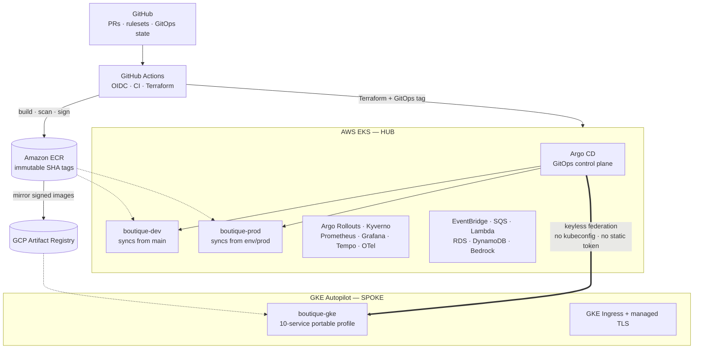
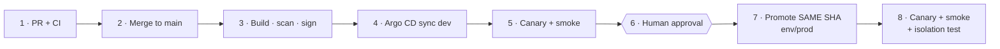
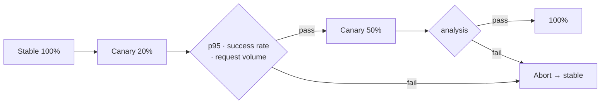
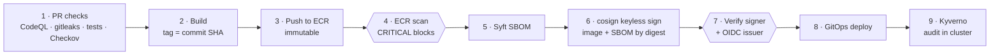
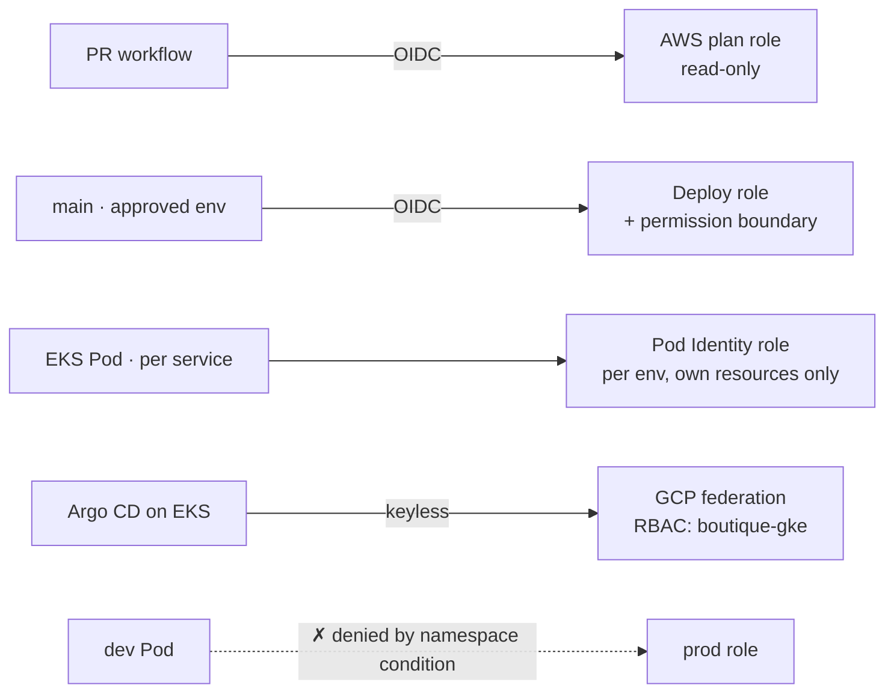
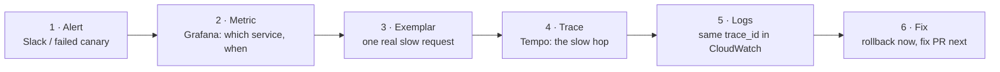
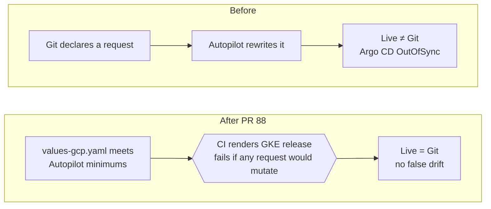
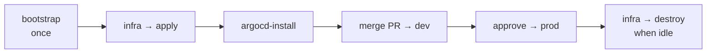

<div align="center">

# Sec-GitOps Platform

### From Commit to Confidence

**A secure GitOps hub-and-spoke platform for resilient multi-cloud delivery**

[](https://github.com/ngems1/Sec-GitOps-platform/actions/workflows/deploy.yml)
[](https://github.com/ngems1/Sec-GitOps-platform/actions/workflows/ci.yml)
[](https://github.com/ngems1/Sec-GitOps-platform/actions/workflows/infra.yml)
[](https://github.com/ngems1/Sec-GitOps-platform/actions/workflows/codeql.yml)


**Sebastien Ngembou** · Senior Cloud Architect / DevOps Lead · [github.com/ngems1](https://github.com/ngems1)

</div>

---

## In 30 seconds

> **Every change is a business risk** — to revenue, to customers and to compliance.
> This platform makes change **safe by default**: every change is tested, approved, signed,
> released progressively, automatically reversible and continuously reconciled.

- **What it runs:** a 12-service retail application (Go, Python, C#/.NET, Java, Node.js, gRPC) on **AWS EKS**, plus a portable profile on **GKE Autopilot** — both deployed by **one Argo CD**.
- **What it proves:** DevSecOps, GitOps, progressive delivery, keyless identity, observability, governed AI, cost control and multi-cloud design, working together end to end.
- **How it is run:** like a production platform — protected `main`, PR reviews, prod approval, runbooks, ADRs, chaos and load tests.

| 📌 Quick links | |
|---|---|
| One-page summary | [README-EXECUTIVE.md](README-EXECUTIVE.md) |
| Deep architecture (12+ diagrams) | [docs/architecture.md](docs/architecture.md) |
| Decisions (ADRs 0001–0014) | [docs/adr/](docs/adr/) |
| Runbook | [docs/week3/RUNBOOK.md](docs/week3/RUNBOOK.md) |

---

## Results that matter

| | Proof (from this platform's own tests) | What it means for the business |
|---|---|---|
| ⚡ **Reliability** | Pod back to Ready in **5 s**, **0 failed requests** (chaos test) | Less downtime, revenue protected |
| 📈 **Scale** | Home page **~10× faster** with autoscaling under an **800-user** stress test | Peak traffic without paying for peak all year |
| 🔐 **Security** | **0** long-lived cloud keys; **every image scanned and signed** | Lower breach risk, audit-ready |
| 🔁 **Reversibility** | Rollback = redeploy a previous SHA, **nothing rebuilt** | Bad releases are cheap to undo |
| 🧱 **Isolation** | dev → prod **blocked** at network, IAM and data layers, tested after every prod deploy | One environment cannot damage another |
| 💰 **Cost** | **$9–12/day** while running; destroyed when idle | Predictable, controllable spend |

> **Next:** the platform is built to improve the four **DORA** metrics (deployment frequency, lead
> time, change failure rate, time to restore). Measuring them from the pipeline history is on the roadmap.

---

## Architecture at a glance



**Hub-and-spoke:** AWS EKS hosts the GitOps control plane and the primary dev/prod workloads; GKE is a
spoke governed by the **same** delivery model, identity model and supply chain — without static credentials.

---

## How a change ships





- **Production never rebuilds** — it receives the exact image validated in dev.
- **Git is the source of truth** — manual drift is reverted by Argo CD self-heal.
- **A bad release reaches 20% of users, not 100%.**

---

## Security and software supply chain



| Layer | Control | Status |
|---|---|---|
| Source | **CodeQL** SAST (Go, C#, Java, JS, Python, workflows) · **gitleaks** | Blocking |
| Infrastructure | **Terraform plan** review · **Checkov** | Checkov soft-fail (informs) |
| Images | **ECR scan-on-push**, CRITICAL blocks · immutable SHA tags | Blocking |
| Provenance | **Syft** SPDX SBOM · **cosign** keyless (Sigstore) · signature + attestation verify | Blocking |
| Cluster | **Kyverno** signature + SBOM verification | Audit today → enforce next |

For every running Pod we can answer: **what is running, who built it, what is inside it, and was it scanned.**

> Why no Trivy? After the 2026 Trivy GitHub Actions supply-chain compromise, scanning moved to **ECR
> native scanning**, so no third-party action runs with AWS credentials.

---

## Identity and least privilege



**No standing credentials in pipelines. No broad cloud permissions inside Pods.** Plus deny-all
NetworkPolicies, Pod Security Standards, ResourceQuota/LimitRange, PDBs, PriorityClass, non-root and
read-only containers.

---

## Reliability and self-healing

| Failure | Automatic recovery |
|---|---|
| Process crash / Pod not ready | Kubernetes restart; readiness removes it from traffic |
| Load spike | HPA adds replicas (nodes scale 2 → 5) |
| Deployment never ready | Helm `--rollback-on-failure` |
| Unhealthy canary | Argo Rollouts aborts → stable |
| Failed smoke test / GitOps sync | Previous revision or GitOps revert |
| Manual drift | Argo CD self-heal |
| Consumer failure / duplicate events | SQS retry → DLQ · idempotent consumers |

> **Honest maturity:** self-healing at the workload, deployment, configuration and event layers.
> Root-cause fixes (database, IAM, design) are still human — safe AIOps is on the roadmap.

---

## Observability: why each tool

| Tool | Why we chose it | Technical value | Business value |
|---|---|---|---|
| **Prometheus** | Kubernetes-native metrics | SLIs, canary analysis, HPA signals | Releases judged on user impact |
| **Grafana** | One view for all signals | Dashboards, exemplars, trace ↔ log links | Same evidence for engineers and managers |
| **OpenTelemetry** | Vendor-neutral, all 5 languages | One trace across 12 services | No monitoring vendor lock-in |
| **OTel Collector** | Central filter and sampling | Tail sampling, span metrics, service graph | All errors kept, lower trace cost |
| **Tempo** | Low-cost trace storage | Find the slow hop in a request | Cheap tracing (24 h retention) |
| **CloudWatch** | AWS-native logs and alarms | Container logs, ALB / SQS / RDS metrics | No extra tool for AWS services |
| **Slack** | Where the team already works | Deploy, alarm, DLQ and budget alerts | Faster reaction to incidents |

**Collector design:** health checks filtered first · 100% of errors and slow traces kept, 10% of normal
prod traffic · metrics built from all spans *before* sampling · no PII, payloads or AI prompts collected.

### Debugging in practice: from alarm to root cause



**Real drill — chaos `consumer-failure`, 8 min:** backlog alarm 🔴 in Slack → Grafana shows the inventory
queue growing → cause: consumer stopped → restart → backlog drains → alarm 🟢, queued orders processed,
DLQs at 0. **Evidence, not guessing — and no lost orders.**

---

## High availability: when one cloud fails

October 2025 showed the cost of depending on one provider:

- **Oct 29, 2025 — Azure:** one accidental configuration change in Azure Front Door caused about
  **8 hours of global disruption** (airlines, airports, retailers, Microsoft 365).
  [Parametrix](https://www.parametrixinsurance.com/blog/azure-afd-outage-what-parametrix-monitored-in-real-time)
- **Oct 20, 2025 — AWS us-east-1:** ~**70,000 organizations** hit; insured losses estimated at
  **$38M–$581M**. [CyberCube](https://www.businesswire.com/news/home/20251023532923/en/CyberCube-Reveals-Insurance-Loss-Estimate-for-AWS-Amazonk-Outage)

| Layer | What this platform has today | Protects against |
|---|---|---|
| Zones | 2 AZs, Multi-AZ RDS in prod, Pods spread across zones | A data-center failure |
| Releases | Canary + automatic rollback | Our own bad config change (the Azure failure mode) |
| GitOps hub | The GKE spoke keeps serving if the hub is down | Hub outage: only deploys wait |
| Cloud | Storefront also running on GKE (Google Cloud) | A provider-wide outage |
| **Next** | Health-checked DNS failover + data replication | Full multi-cloud failover |

> **Honest status:** GKE is a second running storefront today. Order storage, order emails and the AI
> assistant stay on AWS until data replication, order consistency and event replication are built.

---

## Governed AI and cost engineering

| Amazon Bedrock shopping assistant | Cost engineering |
|---|---|
| Read-only, catalog-only tools — no orders, no infra actions | **$9–12/day** while running, destroy workflow when idle |
| PII masked before the model call | Shared EKS with strict dev/prod isolation |
| Per-session rate limit · daily cap · concurrency limit | Dev single-AZ RDS, prod Multi-AZ |
| Token, timeout and tool-step limits | Requests sized from 24 h Prometheus p95/max |
| Answers validated against real product IDs | 110 Pods per node (VPC CNI prefix delegation) instead of 17 |
| Model-scoped IAM · no prompt/answer logging | Trace sampling, short log retention, ECR lifecycle |
| AWS Budgets alerts at 50% and 100% | Bedrock budgets + daily kill switch |

**Trade-offs accepted on purpose:** one NAT gateway, one account and cluster, single-replica Tempo and
OTel Collector — cheaper, documented, and on the roadmap to fix when the business needs it.

---

## Case study: PR #88

**"ops: align GKE requests with Autopilot minimums"** — merged Oct 19, 2026 · 2 files · +45 / −16



> **We turned a cloud-provider runtime behavior into a tested platform contract.**

---

## Complete toolchain

| Category | Tools |
|---|---|
| **Cloud** | AWS (EKS, ECR, RDS MySQL 8.4, ElastiCache Redis, DynamoDB, EventBridge, SQS, Lambda, SES, Route 53, ACM, KMS, Secrets Manager, CloudWatch, SNS, Budgets, Bedrock) · GCP (GKE Autopilot, Artifact Registry, Cloud NAT, Managed Prometheus, Cloud Monitoring) |
| **Infrastructure as Code** | Terraform (AWS + GCP, bootstrap stacks, `terraform test`), Helm |
| **CI/CD** | GitHub Actions, GitHub Environments, branch rulesets, CODEOWNERS, GitHub App for GitOps commits |
| **GitOps & delivery** | Argo CD (automated sync, prune, self-heal), Argo Rollouts (ALB canary + Prometheus analysis) |
| **Security** | CodeQL, gitleaks, Checkov, ECR scanning, Syft, cosign / Sigstore, Kyverno, IAM permission boundaries, KMS |
| **Identity** | GitHub OIDC, EKS Pod Identity, GCP Workload Identity Federation |
| **Kubernetes** | NetworkPolicies (VPC CNI), Pod Security Standards, HPA, PDB, PriorityClass, ResourceQuota, LimitRange, AWS Load Balancer Controller, metrics-server |
| **Observability** | Prometheus, Grafana, OpenTelemetry SDKs + Collector, Grafana Tempo, CloudWatch Container Insights, Slack alerts |
| **Testing** | go test `-race`, xUnit, unittest, npm test, Gradle, Helm render tests, `promtool`, Locust load/stress, chaos workflows, isolation tests, GKE e2e |
| **Languages** | Go, Python, C#/.NET, Java, Node.js, Bash, HCL, SQL · gRPC + Protocol Buffers |
| **Local dev** | Docker Compose (MySQL, Redis, DynamoDB Local), Docker Buildx |

## Engineering techniques

GitOps · trunk-based GitHub Flow · immutable artifacts · build once, promote many · progressive delivery
(canary) · automated rollback · policy as code · software supply-chain security (SBOM, keyless signing,
provenance verification) · keyless identity / zero standing credentials · least privilege · defense in
depth · event-driven architecture with DLQs and idempotent consumers · SLIs and evidence-based release
gates · tail sampling and trace–metric–log correlation · chaos engineering · load and stress testing ·
FinOps / right-sizing from real usage · hub-and-spoke multi-cloud · ADR-driven design · runbooks.

## Skills this project demonstrates

| Competency | Where to look |
|---|---|
| Platform engineering & paved road | [Architecture](#architecture-at-a-glance), [docs/architecture.md](docs/architecture.md) |
| DevSecOps & supply chain | [Security](#security-and-software-supply-chain), ADRs [0012](docs/adr/0012-image-signing-sbom.md), [0013](docs/adr/0013-kyverno-image-signatures-audit.md) |
| Cloud security & IAM | [Identity](#identity-and-least-privilege), [SECURITY.md](docs/week3/SECURITY.md) |
| SRE: reliability, incidents, chaos | [Reliability](#reliability-and-self-healing), [Debugging](#debugging-in-practice-from-alarm-to-root-cause), [RUNBOOK.md](docs/week3/RUNBOOK.md) |
| Multi-cloud architecture | [High availability](#high-availability-when-one-cloud-fails), ADR [0014](docs/adr/0014-multicloud-gke-portable-profile.md) |
| FinOps & AI governance | [Governed AI and cost](#governed-ai-and-cost-engineering), ADR [0009](docs/adr/0009-shopping-assistant-bedrock.md) |
| Technical leadership | ADRs, honest trade-offs, roadmap ranked by business risk |

---

## Screenshots

<table>
<tr>
<td width="50%"><br><sub>The shop — release SHA in the footer</sub></td>
<td width="50%"><br><sub>Real order email from Amazon SES</sub></td>
</tr>
<tr>
<td colspan="2"><br><sub><code>deploy.yml</code>: builds → dev → approval → prod → isolation test</sub></td>
</tr>
<tr>
<td><br><sub>Grafana during a load test</sub></td>
<td><br><sub>Chaos <code>pod-failure</code>: Ready in 5 s, 0 errors</sub></td>
</tr>
<tr>
<td><br><sub>CodeQL SAST on all languages and workflows</sub></td>
<td><br><sub>Backlog alarm 🔴 → 🟢 during the consumer-failure drill</sub></td>
</tr>
</table>

---

## Run it

**Locally** (Docker Desktop, 6 GB):

```powershell
docker compose up --build -d
# Shop  http://localhost:8080   ·   Stock API  http://localhost:8081/stock
```

**On AWS** (all through GitHub Actions, no local credentials):



GKE spoke: `bootstrap-gcp` → `infra-gcp` → `mirror-images-gcp` → `argocd-gke` → `gke-e2e`.
Full guides: [SETUP.md](docs/week3/SETUP.md) · [DEPLOY.md](docs/week3/DEPLOY.md) · [ARGOCD.md](docs/week3/ARGOCD.md) · [LOCAL.md](docs/week3/LOCAL.md).

<details>
<summary><b>Repository layout</b></summary>

```text
src/                         12 services + loadgenerator (Go, Python, C#, Java, Node.js)
protos/                      gRPC definitions
helm-chart/                  Kubernetes app, guardrails, values per environment and cloud
gitops/                      Desired state and image tags per environment
terraform-bootstrap/         AWS state, OIDC roles, permission boundaries, budgets
terraform-aws/               VPC, EKS, data stores, events, IAM, DNS, monitoring
terraform-gcp-bootstrap/     GCP Workload Identity Federation and state
terraform-gcp/               GKE Autopilot spoke and Artifact Registry
monitoring/                  Prometheus, Grafana, Tempo, OTel Collector
deploy/                      Smoke, rollback, canary, chaos, signing and diagnostic scripts
tests/                       Platform tests (GKE e2e, rendered-manifest checks)
docs/                        Architecture, ADRs, runbook, security notes
.github/workflows/           CI, CodeQL, infra, deploy, GitOps and operations workflows
```

</details>

<details>
<summary><b>Workflows</b></summary>

| Workflow | Purpose |
|---|---|
| `ci.yml` | Tests in 5 languages, gitleaks, Helm render, platform checks → `ci-ok` |
| `codeql.yml` | SAST on every PR, `main` and weekly |
| `infra.yml` / `infra-gcp.yml` | Terraform plan / apply / destroy + Checkov |
| `deploy.yml` / `deploy-env.yml` | Build, scan, SBOM, sign, verify, dev → approval → prod |
| `argocd-install.yml` / `argocd-gke.yml` | Argo CD install and GKE spoke registration |
| `mirror-images-gcp.yml` · `gke-e2e.yml` | Signed image mirror · GKE end-to-end tests |
| `isolation-test.yml` · `chaos.yml` · `load-test.yml` | Isolation proof · failure injection · stress tests |
| `order-flow.yml` · `cluster-status.yml` · `assistant-smoke.yml` | Operations and diagnostics |

</details>

---

## Roadmap — ranked by business risk

| # | Next step | Business risk removed |
|---|---|---|
| 1 | Kyverno audit → **enforce** | Unverified software in production |
| 2 | Checkov **blocking** after triage | Risky infrastructure changes merged |
| 3 | **WAF** + private EKS API endpoint | Web attacks, exposed control plane |
| 4 | **Multi-account** (prod / non-prod / security) | Large blast radius per incident |
| 5 | Durable, HA observability (Tempo on object storage, OTel LB tier) | Lost incident evidence |
| 6 | DNS failover + data replication | Single-provider outage |
| 7 | **Safe AIOps**: diagnosis, runbook advice, human-approved recovery | Slow recovery, on-call load |

---

<div align="center">

**We are not building a faster pipeline. We are making change safe by default —**
**secure, observable, governed, reversible, and portable across clouds.**

**Sebastien Ngembou** · [github.com/ngems1](https://github.com/ngems1)

</div>
