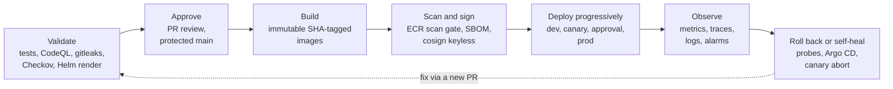
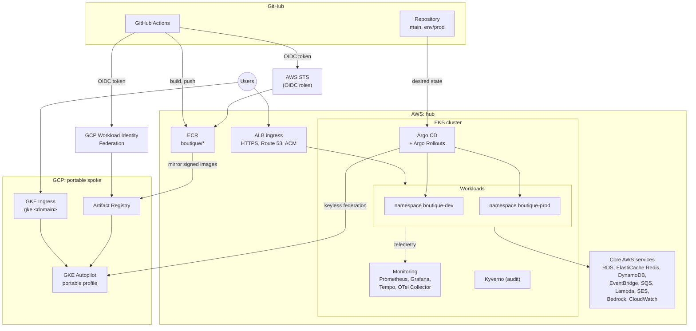
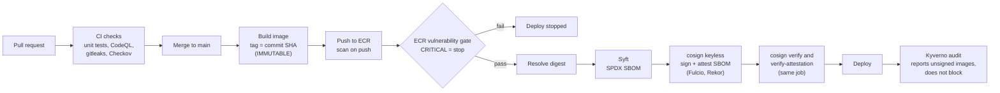
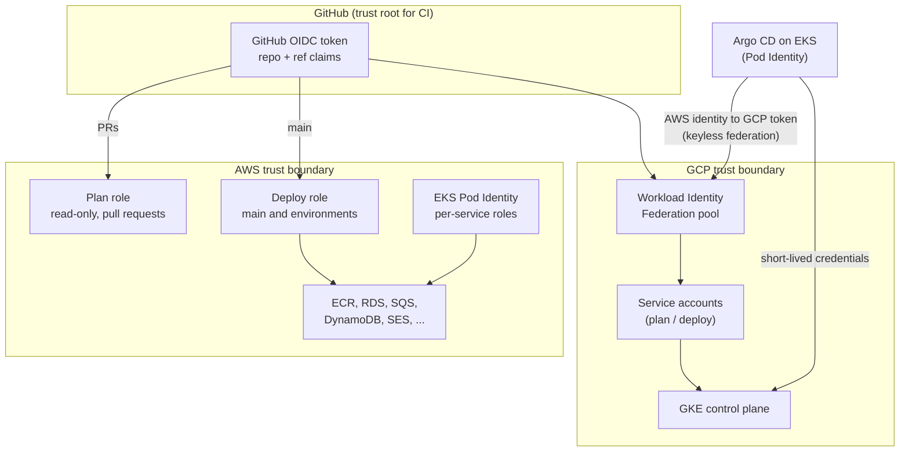
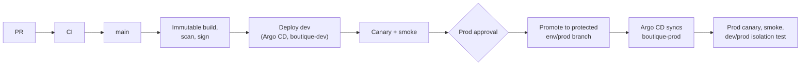
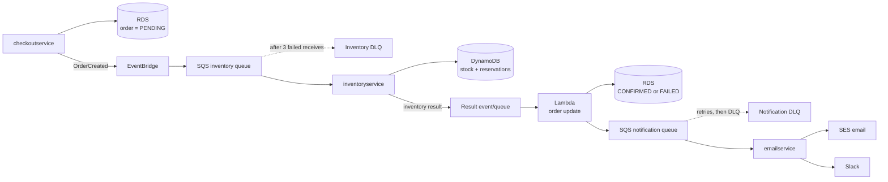
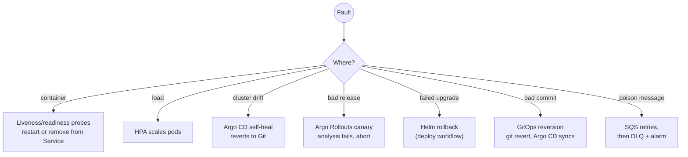
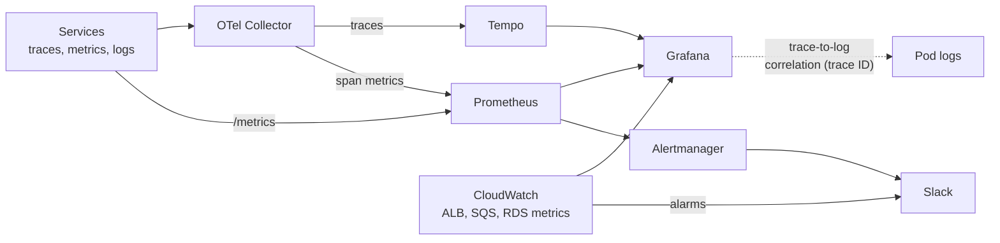
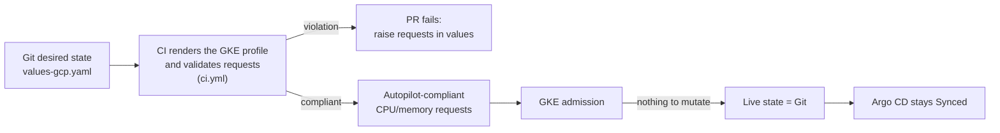

# Architecture

A deep-dive companion to the [README](../README.md). It describes the platform as a secure
GitOps **hub-and-spoke**: Amazon EKS is the hub, GKE Autopilot is a governed portable spoke.
Decisions are in [docs/adr/](adr/), notably [0012](adr/0012-image-signing-sbom.md) (SBOM and
signing), [0013](adr/0013-kyverno-image-signatures-audit.md) (Kyverno audit) and
[0014](adr/0014-multicloud-gke-portable-profile.md) (EKS hub, GKE spoke).

- **EKS (hub):** GitHub Actions automation, the Argo CD control plane, the dev and prod
  workloads, the primary observability stack, and the AWS data and event services.
- **GKE Autopilot (spoke):** managed from Argo CD on EKS through keyless EKS-to-GCP federation.
  It runs signed images mirrored from ECR to Artifact Registry.
- **GKE is not active-active production failover today.** It intentionally excludes the
  AWS-specific data and event plane (RDS, EventBridge, SQS, DynamoDB, SES, the order-status
  Lambda), the Bedrock shopping assistant, the inventory flow, the EKS canary implementation
  (an ALB feature here) and the central EKS monitoring stack.

## 1. Platform lifecycle

Every change follows the same loop, from a pull request to self-healing in the cluster.

## 2. Hub-and-spoke topology

## 3. Secure software supply chain

Nothing is signed with a long-lived key; the signing identity is the `deploy.yml` workflow on
`main` (ADR 0012).

## 4. Identity and trust boundaries

There are no static cloud access keys and no static Kubernetes tokens.

## 5. EKS deployment and promotion

## 6. Event-driven order flow (EKS only)

- **Retries and DLQs:** failed messages return to the queue and move to a dead-letter queue
  after `maxReceiveCount` (3 for the inventory queue); DLQ depth raises a CloudWatch alarm.
- **Idempotency:** `inventoryservice` creates `RESERVATION#<orderId>` only if it does not
  already exist, so redelivery never reserves stock twice; the email consumer deduplicates
  notifications.

## 7. Automatic recovery and rollback

## 8. Observability signal flow (EKS)

See ADR [0010](adr/0010-opentelemetry-tracing.md) and
[0011](adr/0011-linking-traces-metrics-logs.md).

## 9. GKE Autopilot admission and drift prevention

GKE Autopilot rewrites Pod requests that fall below its minimums (at least 50m CPU per
container, and at least 1 GiB of memory per vCPU). A rewritten live Pod no longer equals Git,
so Argo CD would show a false `OutOfSync`. PR #88 encoded these constraints in
`helm-chart/values-gcp.yaml` and added a rendered-manifest check to CI.

Requests that already comply are not mutated, so the live state equals Git and Autopilot bills
the same as before.

## Current boundaries and future evolution

- **Kyverno is in audit mode** (ADR 0013); it reports but does not block. Next: enforce after
  audit reports are clean.
- **No failover:** GKE is a portable spoke, not a second production site. Next: replicate data
  across clouds before any failover is considered.
- **Observability** is a single-cluster stack. Next: durable and highly available storage.
- **Edge:** add a WAF and harden the EKS API endpoint.
- **AIOps:** add safe, bounded automated remediation.
