# Architecture

> Companion to the [README](../README.md) and the [executive summary](../README-EXECUTIVE.md).
> Decisions are recorded in [docs/adr/](adr/).

This document explains **how the platform is built**, in five views:

1. [Context — who and what](#1-context)
2. [Hub-and-spoke control plane](#2-hub-and-spoke-control-plane)
3. [AWS hub — runtime architecture](#3-aws-hub--runtime-architecture)
4. [GKE spoke — runtime architecture](#4-gke-spoke--runtime-architecture)
5. [Security architecture](#5-security-architecture)
6. [Deployment architecture](#6-deployment-architecture)
7. [Recovery and self-healing](#7-recovery-and-self-healing)
8. [Observability architecture](#8-observability-architecture)
9. [Design decisions and trade-offs](#9-design-decisions-and-trade-offs)
10. [Evolution path](#10-evolution-path)

---

## 1. Context

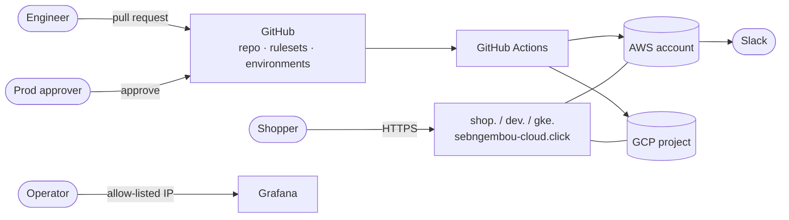

| Actor | Interaction |
|---|---|
| Engineer | Proposes every change through a pull request; no direct cluster access is needed for delivery |
| Prod approver | Approves the `prod` GitHub Environment after dev verification |
| Shopper | Uses `shop.` (EKS prod), `dev.` (EKS dev) or `gke.` (GKE spoke) |
| Operator | Reads Grafana from allow-listed IPs; receives alarms in Slack |

---

## 2. Hub-and-spoke control plane

Hub-and-spoke here means **centralized platform governance with distributed runtime environments**,
not only VPC routing.

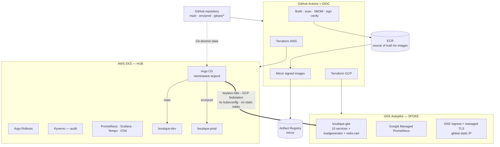

### Responsibilities

| Concern | Hub (AWS EKS) | Spoke (GKE Autopilot) |
|---|---|---|
| GitOps control plane | Argo CD runs here | Target cluster only |
| Release process | GitHub approvals, promotion branch | Inherits the same process |
| Artifact provenance | ECR images, cosign signatures, SBOM attestations | Mirrored signed images in Artifact Registry |
| Configuration | Helm chart + `values-aws.yaml`, `gitops/<env>/values.yaml` | `values-gcp.yaml` |
| Identity | GitHub OIDC → IAM roles; EKS Pod Identity | Workload Identity Federation; RBAC scoped to `boutique-gke` |
| Network | VPC 10.0.0.0/16, 2 AZs, ALBs | Own VPC + subnet, Cloud NAT, GKE Ingress |
| Observability | Prometheus, Grafana, Tempo, OTel Collector, CloudWatch | Managed Service for Prometheus, Cloud Monitoring |
| Runtime constraints | EKS defaults + guardrails | Autopilot minimum requests, enforced in CI (PR #88) |
| Endpoint | `shop.` / `dev.` | `gke.` |

### What is *not* on the spoke (by design)

| EKS-only capability | Why it stays on the hub for now |
|---|---|
| Bedrock shopping assistant | Would need Vertex AI or cross-cloud AWS credentials |
| Inventory, EventBridge, SQS, Lambda, SES, DynamoDB | Async flow needs a GCP-native port (Pub/Sub…) |
| RDS catalog and order history | Needs Cloud SQL and a data-replication decision |
| Argo Rollouts canary | Implemented through the ALB in this repo |
| Tempo tracing, Kyverno | Spoke uses managed monitoring; admission policy not yet extended |

There is **no active-active routing or cross-cloud failover**. Before that is possible: data
replication, order consistency, cross-cloud identity, event replication, stateful failover,
observability and incident ownership, and the cost of complexity must all be solved.

---

## 3. AWS hub — runtime architecture

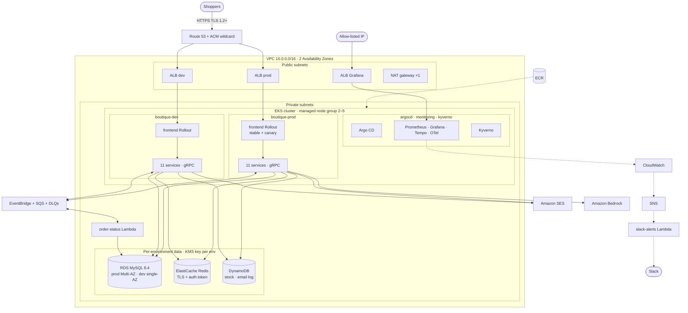

**Dev/prod in one cluster** is a cost decision ([ADR 0003](adr/0003-single-account-hardening.md)).
Separation is enforced at five layers:

| Layer | Mechanism |
|---|---|
| Namespace | `boutique-dev`, `boutique-prod` |
| Network | Deny-all NetworkPolicy + one allow rule per call; prod accepts only prod callers |
| IAM | One Pod Identity role per service per env, with a namespace condition |
| Data | Separate RDS, Redis, DynamoDB tables, queues, event bus, KMS key |
| Entry | One ALB and hostname per environment |

Proven by `isolation-test` after every prod deploy.

---

## 4. GKE spoke — runtime architecture

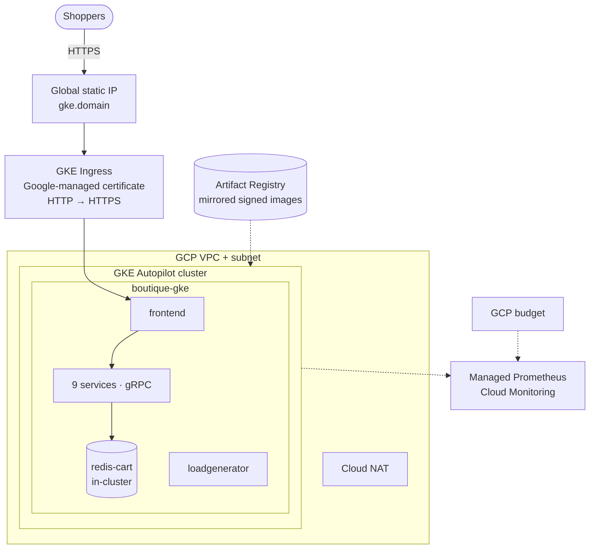

**Autopilot contract.** Autopilot raises requests below its minimums at admission. Because that
creates permanent Argo CD drift, `values-gcp.yaml` declares compliant values and CI renders the GKE
release and fails if any container would be mutated (PR #88).

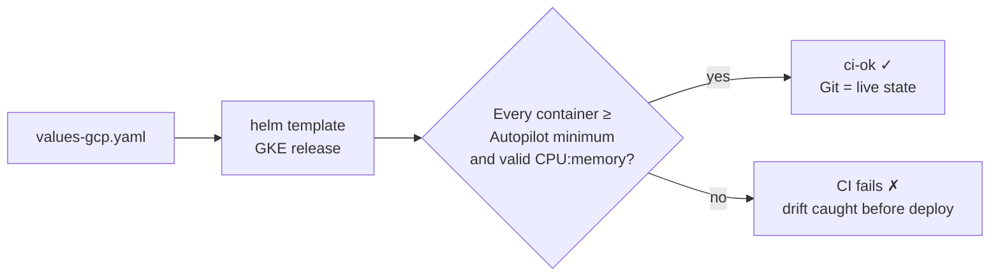

---

## 5. Security architecture

### 5.1 Defense in depth

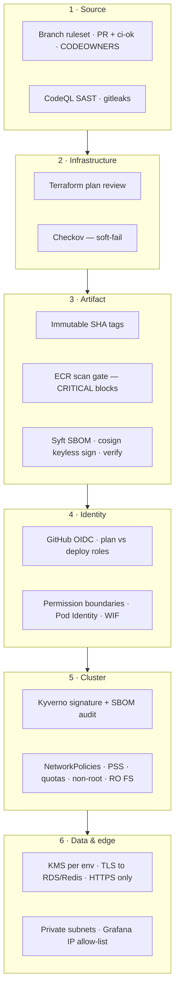

### 5.2 Software supply chain

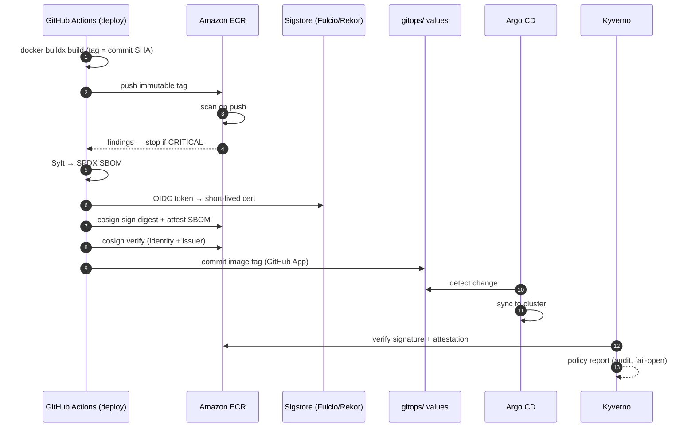

### 5.3 Identity map

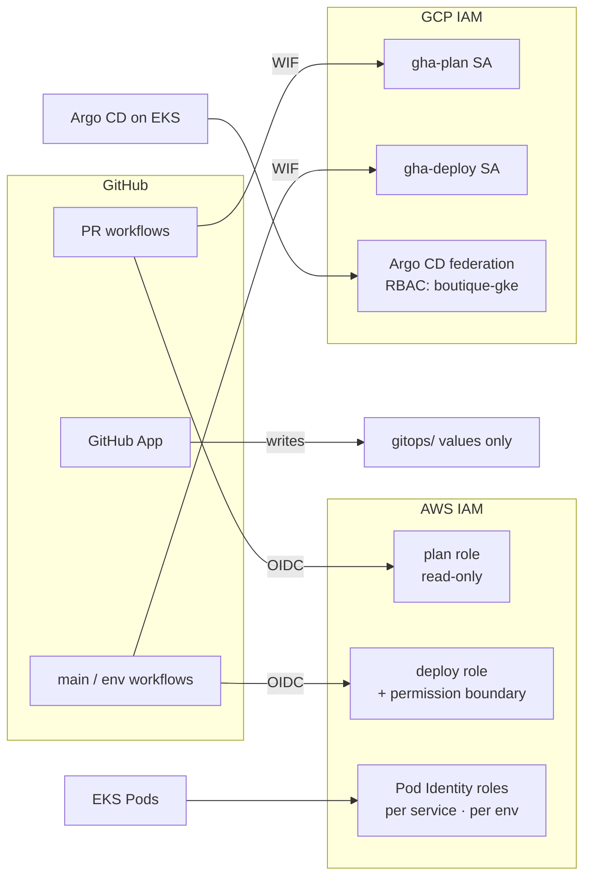

| Principle | Result |
|---|---|
| No stored cloud keys | OIDC / WIF everywhere; no service-account keys exist |
| Separation of duties | PRs can only plan; only `main` / approved environments can deploy |
| Least privilege at runtime | Each service gets only DynamoDB / SQS / EventBridge / SES / Secrets Manager / CloudWatch / Bedrock actions it needs |
| Environment boundary | Namespace condition stops dev Pods from assuming prod roles |

### 5.4 Kyverno: audit → enforce

| Step | Exit criterion |
|---|---|
| 1 | Dedicated Pod Identity role for Kyverno ECR reads |
| 2 | Zero `fail` / `error` reports through deploys, a canary and a rollback |
| 3 | Multiple admission replicas with a PDB |
| 4 | Explicit fail-open vs fail-closed decision |
| 5 | Digest pinning validated with Argo CD + Rollouts ownership |
| 6 | Third-party images pinned by digest or allow-listed |

---

## 6. Deployment architecture

### 6.1 End-to-end release

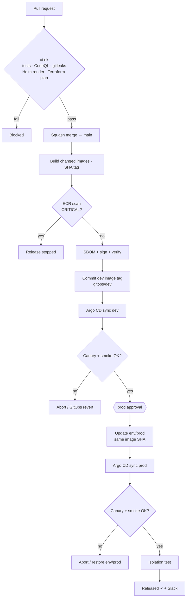

### 6.2 Canary analysis (frontend)

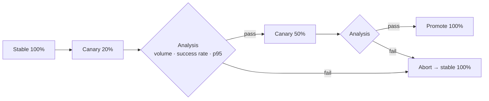

### 6.3 Branches and promotion

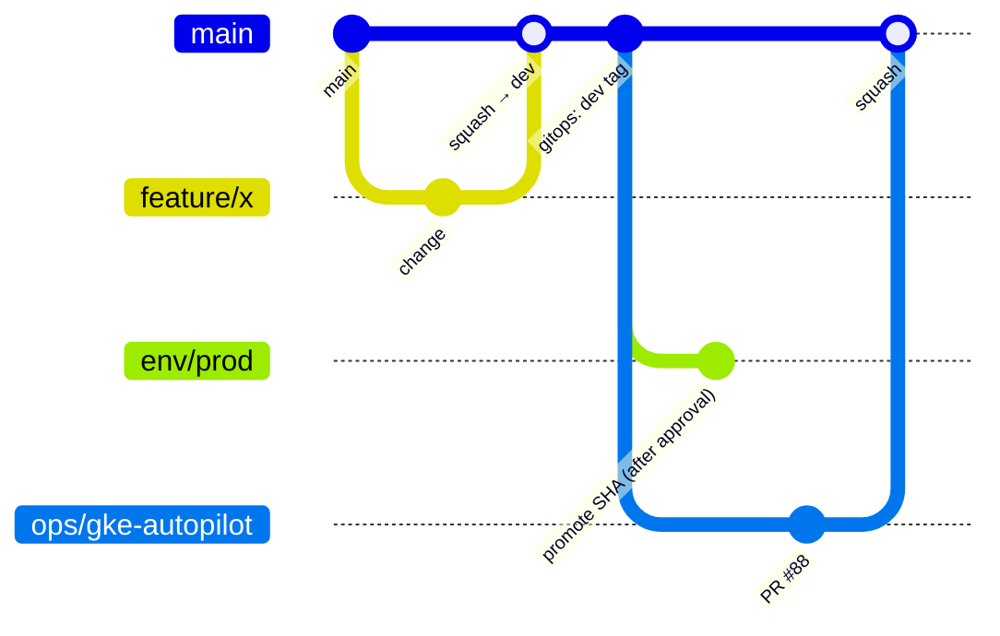

### 6.4 Environment lifecycle

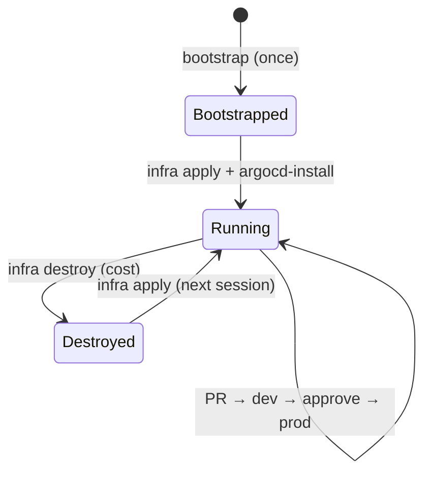

---

## 7. Recovery and self-healing

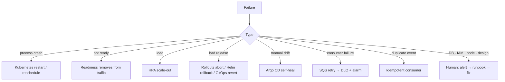

| Layer | Automatic today | Still human |
|---|---|---|
| Workload | Restart, reschedule, readiness, HPA | Capacity planning |
| Deployment | Canary abort, Helm and GitOps rollback | Root cause of the bad change |
| Configuration | Drift correction | Policy design |
| Events | Retries, DLQ, idempotency | DLQ redrive decision |
| Infrastructure / data | Alarms to Slack | RDS, Redis, IAM, node remediation; DR |

---

## 8. Observability architecture

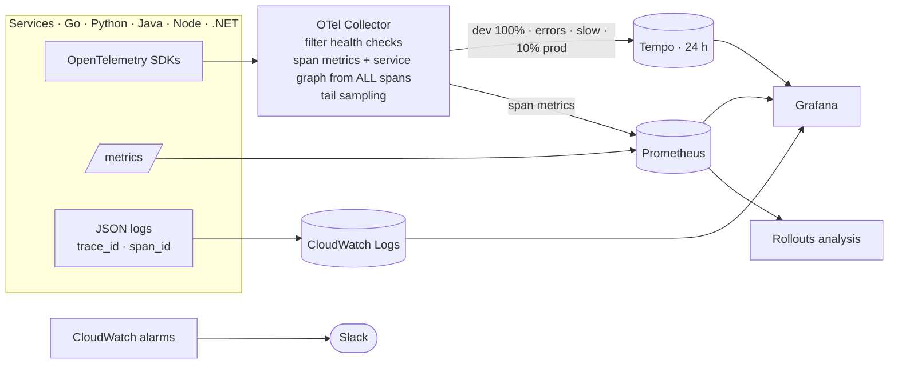

Investigation path: **p95 alert → Grafana panel → exemplar → Tempo trace → correlated log lines →
the dependency responsible.** No PII, session IDs, payloads, card data or AI prompts/responses are
collected.

---

## 9. Design decisions and trade-offs

| Decision | Benefit | Accepted cost / risk | ADR |
|---|---|---|---|
| Argo CD GitOps | Auditable desired state, drift repair | Another control plane to secure | [0001](adr/0001-argo-cd-gitops.md) |
| Single account, hardened | Lower cost, simpler | Shared-fate risk | [0003](adr/0003-single-account-hardening.md) |
| PriorityClass owned by deploy workflow | Prod preempts dev | Ordering coupling | [0006](adr/0006-priorityclass-owned-by-deploy-workflow.md) |
| `env/prod` promotion branch | Explicit prod changes | Extra promotion step | [0007](adr/0007-argocd-prod-promotion-branch.md) |
| ALB canary with Argo Rollouts | Measured releases | Frontend only | [0008](adr/0008-argo-rollouts-alb-canary.md) |
| Guardrailed Bedrock assistant | Safe, bounded AI | Feature limits | [0009](adr/0009-shopping-assistant-bedrock.md) |
| OTel + Tempo, tail sampling | Unbiased metrics, low cost | Single collector, 24 h traces | [0010](adr/0010-opentelemetry-tracing.md), [0011](adr/0011-linking-traces-metrics-logs.md) |
| Keyless signing + SBOM | Provable provenance | Attestations use ECR lifecycle slots | [0012](adr/0012-image-signing-sbom.md) |
| Kyverno in audit | Safe adoption | Not yet a hard control | [0013](adr/0013-kyverno-image-signatures-audit.md) |
| GKE portable profile | Portability proof | Not a failover target | [0014](adr/0014-multicloud-gke-portable-profile.md) |
| One NAT gateway | Cost | Non-HA egress | — |
| ECR scan, not Trivy action | No third-party code with AWS creds | Scan after push, not before | — |

---

## 10. Evolution path

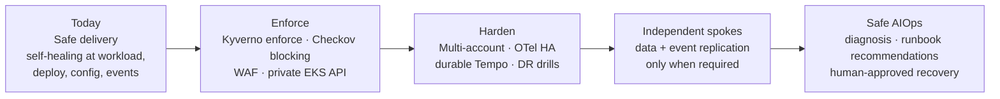

> **Next-phase question:** how do we evolve a centralized GitOps hub into a resilient multi-cloud
> platform where each spoke can operate independently, while policy, provenance, observability and
> recovery remain consistent?
