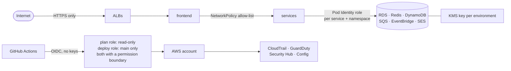

# Security notes

How the platform is protected, layer by layer, and what is still open.

## 1. Pipeline identity (no stored keys)

| Control | Where |
|---|---|
| GitHub signs in with **OIDC**; no AWS access keys exist anywhere | `terraform-bootstrap/`, [BOOTSTRAP.md](BOOTSTRAP.md) |
| `week3-gha-plan`: read-only + state lock, the only role a pull request can get; its **permission boundary** caps it at reading the services terraform-aws uses (no secret values, no table or log contents) | `terraform-bootstrap/main.tf`, `boundaries.tf` |
| `week3-gha-deploy`: trusts only `main` and the `dev` / `prod` environments; its **permission boundary** caps AdministratorAccess (section 2a) | `terraform-bootstrap/main.tf`, `boundaries.tf` |
| `week3-bootstrap`: only usable from the protected `prod` environment | [BOOTSTRAP.md](BOOTSTRAP.md) |
| Prod deploys wait for a reviewer (`prod` environment) | GitHub Environments |
| `main` protected by a ruleset: PR + `ci-ok` required, no force push, no deletion | [GITHUB-FLOW.md](GITHUB-FLOW.md) |

Consequence: a branch, a fork or a pull request can only **read** AWS. Changing anything needs a
merge to `main`.

## 2. Least privilege at runtime

- **EKS Pod Identity**: one IAM role per service per environment
  (`terraform-aws/modules/environment/pod-identity.tf`). Each role only names that environment's
  table, queue, bus or secret, and carries a condition on the pod's namespace tag (ABAC), so a dev
  pod can't use a prod role even by mistake.
- **emailservice → SES**: `ses:SendEmail` only, with the condition
  `ses:FromAddress = orders@<domain>`. It can't send as anyone else.
- **Grafana**: read-only CloudWatch and logs role, logs limited to the project's log groups
  (`terraform-aws/monitoring.tf`).
- **order-status Lambda**: its own role, its queue, its event bus, and `kms:Decrypt` on its key.
- **Company IAM restrictions respected**: the personal IAM user has no SES console or role-creation
  rights outside the allowed prefix; checks that need those (SES status, CloudWatch queries) run in
  workflows with the deploy role instead of bypassing the policy.

## 2a. Account baseline and the CI roles' boundaries (ADR 0003)

One AWS account (D-07), so the controls that a multi-account setup would give by separation are
added inside it. All of them are in `terraform-bootstrap/` (never destroyed; `terraform-aws/` is
destroyed daily and Object Lock would block that) and applied by the `bootstrap` workflow.

| Control | Detail |
|---|---|
| CloudTrail | One multi-region trail, management events, log file validation, KMS-encrypted (`alias/week3-boutique-audit`, rotation on) |
| Audit bucket | `week3-boutique-audit-<account-id>`: S3 Object Lock **GOVERNANCE, 30 days** (no delete or overwrite without `s3:BypassGovernanceRetention`), public access blocked, HTTPS only, deleted after 90 days. CloudTrail under `cloudtrail/`, Config under `config/` |
| GuardDuty | Detector on, foundational detection only (CloudTrail, VPC Flow Logs, DNS); the paid protection plans are turned off explicitly. Findings with severity >= 7 go to `#boutique-alerts` through EventBridge and the slack-alerts Lambda (`terraform-aws/security-alerts.tf`) |
| Security Hub | AWS Foundational Security Best Practices only (CIS not enabled) |
| AWS Config | Records IAM roles, policies and users, S3 buckets, the VPC/EC2 resources (not network interfaces or volumes: too much churn), EKS clusters, RDS, KMS keys. Rules: S3 public access, S3 encryption, RDS encrypted, RDS not public, no root access key, CloudTrail enabled |

**Permission boundaries** (`terraform-bootstrap/boundaries.tf`). A boundary is a ceiling: the role
can do only what both its policies and its boundary allow. The lists come from every AWS call in
`terraform-aws/` and in the workflows that use the roles (listed at the top of the file).

| Role | Boundary allows | Boundary denies (always wins) |
|---|---|---|
| `week3-gha-plan` | `Describe*`/`Get*`/`List*` on the services terraform-aws uses (no `secretsmanager:GetSecretValue`, no DynamoDB, log or S3 object reads), public SSM parameters, the state bucket | everything else |
| `week3-gha-deploy` | acm, cloudwatch, dynamodb, ec2, ecr, eks, elasticache, events, iam, kms, lambda, logs, rds, route53, secretsmanager, ses, sns, sqs; read-only ELB and Auto Scaling; the state bucket only | changing CloudTrail, Config, GuardDuty, Security Hub; the audit bucket; anything tagged `ManagedBy = terraform-bootstrap` (the CI roles, the boundaries, the audit key); the bootstrap role and the GitHub OIDC provider by name; IAM users and access keys; attaching AdministratorAccess, PowerUserAccess or IAMFullAccess; creating a role without `Project = week3-boutique`; any resource tagged with **another** `Project` |

Tag-based conditions use `aws:ResourceTag/Project`, `aws:ResourceTag/ManagedBy` and
`aws:RequestTag/Project` on the services that support them. Resources with no `Project` tag (made by
EKS or the Load Balancer Controller) stay usable, so the daily destroy still works.

## 3. Network

| Control | Detail |
|---|---|
| Public surface | Only the three ALBs (dev, prod, Grafana) |
| Private subnets | EKS nodes, RDS, ElastiCache, Lambda: no public IP, outbound through one NAT gateway |
| RDS / Redis security groups | Port 3306 / 6379 from inside the VPC only; Redis also requires TLS and the environment's auth token |
| NetworkPolicies | Deny-all in each namespace + one allow rule per service call; prod accepts callers only from `boutique-prod`. Enforced by the VPC CNI |
| Grafana | ALB restricted to `MONITORING_ALLOWED_CIDR`; the pipeline refuses `0.0.0.0/0` |
| HTTPS | ACM certificate for `<domain>` and `*.<domain>`, policy `ELBSecurityPolicy-TLS13-1-2-2021-06`, port 80 only redirects |

Proven by the isolation test after every prod deploy ([ISOLATION.md](ISOLATION.md)).

## 4. Data protection

| Store | Encryption | Other |
|---|---|---|
| RDS MySQL | At rest with the environment's KMS key; TLS in transit with certificate verification | Password created and rotated by RDS in Secrets Manager (encrypted with the same key); automated backups; prod Multi-AZ |
| DynamoDB | Server-side encryption | Point-in-time recovery |
| SQS | SQS-managed encryption | DLQs keep failed messages 14 days |
| Migration credentials | Temporary Kubernetes Secret, deleted right after the Job | — |
| Slack webhooks | GitHub secrets; the alerts webhook in Secrets Manager | Never in Terraform, the repo or logs |

## 5. Supply chain

- **Immutable images**: tagged with the commit SHA, ECR `IMMUTABLE` tags, so a tag always means the
  same code and prod runs exactly what passed in dev.
- **CodeQL (SAST)** analyses the application code itself (Go, C#, Java, JavaScript, Python) and
  the GitHub workflows on every pull request, on `main` and weekly (`.github/workflows/codeql.yml`,
  `security-extended` queries). It runs with read-only access and no AWS credentials; findings are in
  the Security tab > Code scanning.
- **ECR scan on push** with a **blocking gate**: a CRITICAL finding stops the deploy before the
  cluster (`SCAN_BLOCKING=false` only reports).
- **Why not Trivy**: the Trivy GitHub Action was compromised in March 2026 (CVE-2026-33634). ECR's
  built-in scanner needs no third-party code running with AWS credentials.
- **Checkov** scans `terraform-aws/` on every infra run (soft-fail: results in the run log, reviewed
  here).
- **Pinned base images and dependencies** per service.

## 6. Containers

All services run as **non-root** with a **read-only root filesystem** (`helm-chart/templates/*`),
CPU and memory limits, and liveness / readiness probes. Grafana runs the distroless image with a
read-only disk (`preinstall_disabled` keeps it from trying to write plugins).

## 7. Known gaps (remediation plan)

| Gap | Risk | Fix |
|---|---|---|
| ~~Prod Redis reachable from dev pods, no auth, no TLS~~ | Fixed | ElastiCache with TLS required and an auth token per environment (token in the encrypted Terraform state, delivered as a Kubernetes Secret); isolation test checks dev gets `NOAUTH` |
| ~~No ResourceQuota / LimitRange~~ | Implemented, pending first deploy | ResourceQuota + LimitRange per namespace (dev sized so a stress test still fits); PriorityClass: prod outranks and may preempt dev; PodDisruptionBudget, topology spread and preStop per service |
| Pod Security Standard only at `baseline` | A pod could run as root (privileged pods are already blocked) | Pod Security labels implemented, pending first deploy: `baseline` is enforced and `restricted` audited/warned on both namespaces; the db-migrate Job and the isolation probe already run as non-root; move to enforcing `restricted` once the cluster shows no `restricted` warnings |
| EKS API endpoint public | Exposed to the internet (still IAM-authenticated) | Restrict `cluster_endpoint_public_access_cidrs` or go private + runner in the VPC |
| Admin-only cluster access | No per-namespace roles | EKS access entries: edit in dev, view in prod |
| Checkov in soft-fail | Findings don't block | Fix or explicitly skip each finding, then make it blocking |
| No WAF on the ALBs | No managed-rule filtering | AWS WAF with managed rule groups on the prod ALB |
| RDS `deletion_protection = false` | Accidental deletion | Kept off so the daily `destroy` works; turn on for a real prod |
| SES in sandbox | Only verified recipients | Request production access when real customers exist |
| Deploy role can create a role without a boundary and give it broad inline rights | Privilege escalation inside the account (admin-level managed policies and IAM users are already denied) | Require a permission boundary on every role terraform-aws creates (`iam:PermissionsBoundary` condition on `iam:CreateRole`) |
| GuardDuty foundational only | No S3 data-event, EKS audit-log, runtime, malware, RDS login or Lambda network detection | Turn single protection plans on in `terraform-bootstrap/security.tf` when the budget allows (EKS audit logs first) |
| Security services in one region | GuardDuty, Security Hub and Config cover `us-east-1` only (the trail is multi-region) | Enable them in other regions if anything ever runs there |
